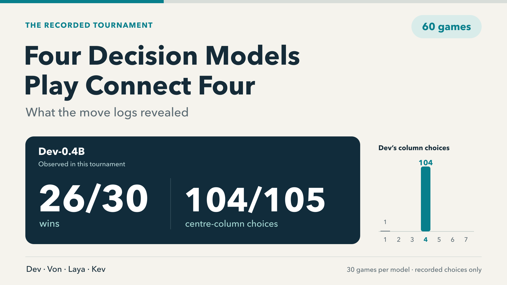

# Four decision models play Connect Four



A recorded 60-game experiment comparing **Dev-0.4B, Von, Laya English and Kev-4B**. Dev won 26 of its 30 games, while choosing the centre column on 104 of its 105 turns. It won 23/24 games with preset openings versus 3/6 from an empty board, and played a safe block on 0/10 encountered turns where one existed and it had no immediate win itself.

Those observations limit what the leaderboard tells us. This repository documents this experiment, not a global ranking of decision models. All performance findings are calculated from the included game records; no external benchmark scores are used.

## Recorded results

| Model | Wins | Losses | Win rate |
|---|---:|---:|---:|
| Dev-0.4B | 26 | 4 | 86.7% |
| Von | 17 | 13 | 56.7% |
| Laya English | 9 | 21 | 30.0% |
| Kev-4B | 8 | 22 | 26.7% |

Six pairings × five fixed starting positions × both player assignments = **60 games**. Each entrant played 30 games, 15 from each seat. Every game ended in a board win. All 581 model decisions were legal, with no recorded failures, truncation or forfeits. The engine supplied legal choices, so this is not a test of discovering legality unaided.

[Read the complete observed results and limitations](docs/RESULTS.md), including pairwise scores, opening sensitivity, immediate tactical checks and carefully labeled local response-time observations.

## Watch selected highlights

**[Start with the action excerpt: Von vs Laya, moves 15–24](media/highlights/00_Von_vs_Laya_Block_Exchange.mp4).** It begins from the actual board after move 14 and shows every remaining move, including four successful blocks and the finish. The full game is linked below.

These three replays were selected **after reviewing the outcomes** for visible defensive blocks and game length. They are illustrative highlights, not a representative sample. All 60 games, including straightforward non-blocking games, remain in the results.

1. [Von vs Laya: four successful blocks](media/highlights/01_Von_vs_Laya_Blocks.mp4). The full replay starts from an empty board and lasts 24 moves. Laya wins, although Von won nine of their ten games overall.
2. [Von vs Laya: the longest recorded game](media/highlights/02_Von_vs_Laya_Longest.mp4). 31 placements including four preset opening pieces; Von wins. One successful defensive block.
3. [Kev vs Von: a defensive block in column 1](media/highlights/03_Kev_vs_Von_Block.mp4). 20 placements including four preset opening pieces; Von wins.

One large board per video, verified block labels, no audio, and one second per model move. Preset pieces are labeled as starting positions. Playback pace does not compare model speed. [Selection and media checks](media/highlights/QA.json).

The [original two-board replay](media/gameplay.mp4) is retained for reference. Its two matches were selected before outcomes; the new highlight set was selected afterward.

## Replay and reproduce the analysis

Python 3.10 or newer is sufficient; no third-party package, model download or API access is required for these commands.

```sh
git clone https://github.com/dagar1994/decision-model-connect-four.git
cd decision-model-connect-four
python3 src/audit_replay.py
python3 src/audit_replay.py --match pair-01-opening-00-leg-1
python3 src/analyze_observed.py --output observed-statistics.json
python3 -m unittest discover -s tests -v
```

The audit checks the frozen protocol and source hashes, all 60 movesets, legal choices, board outcomes, model revisions, seat balance, probability selections and the recalculated statistics. The replay command prints each board of the chosen saved match. The analysis command recomputes descriptive statistics from recorded moves without calling a model. The existing 26 tests passed on the publication copy.

## Repository contents

- `src/`: frozen game engine and tournament harness, plus portable replay and post-hoc analysis tools.
- `tests/`: game-rule, tournament and portable-analysis checks.
- `evidence/matches/`: all 60 original recorded matches, including prompts, model choices, probabilities and measured response times.
- `evidence/protocol.json`: the schedule, openings, model revisions and rules fixed before scored games.
- `evidence/results.json`: the complete recorded tournament.
- `evidence/OBSERVED_STATISTICS.json`: post-hoc statistics and immediate tactical event references.
- `evidence/INDEPENDENT_OBSERVED_ANALYSIS.json`: a separate calculation from the original game logs.
- `inference/`: retained adapters and an adapted launcher for documenting the original model run. **Fresh inference requires separate large weights, pinned upstream checkouts and isolated environments.** See [its setup boundaries](inference/README.md); this is not a tested one-command installation.
- `media/`: gameplay video and cover assets.

The original 60 game files and frozen engine/harness source are preserved byte-for-byte. `evidence/PORTABLE_EXPORT.json` records the portable export checks. Nothing here requires the private machine paths or credentials used during preparation.

## Interpretation boundaries

The five starts were fixed, not drawn randomly or solver-certified as equal. Each model played only six games from an empty board; repeated positions also make observations correlated. We did not test random play, a centre-column policy, a human or an optimal solver.

Immediate win and safe-block counts describe positions the models encountered, with different denominators. They are not matched-position tactical accuracy scores. No model should be credited with strategic understanding solely from these results.

We used one recorded configuration per model, without additional game training or tactical search. Von chains were off. Kev used MLX bf16 with a float32 head; the others used CPU float32. Local timings are not a controlled intrinsic-speed comparison.

## Model attribution

Exact weight/source revisions and runtime settings are in [`src/models.json`](src/models.json). These links identify the models tested; their published claims are not the basis of our observed findings.

- [Dev-0.4B](https://huggingface.co/mpnikhil/dev-0.4b)
- [Kev-4B](https://huggingface.co/jaredpalmer/kev-4b)
- [Von](https://huggingface.co/wfzyx/von)
- [Laya English](https://huggingface.co/convaiinnovations/laya)

Experiment recorded 29 September 2026; post-hoc analysis completed 30 September 2026. Prepared with AI assistance. Code and assets in this repository are provided under Apache-2.0; upstream models and dependencies retain their own licenses. See [LICENSE](LICENSE) and [NOTICE](NOTICE).
